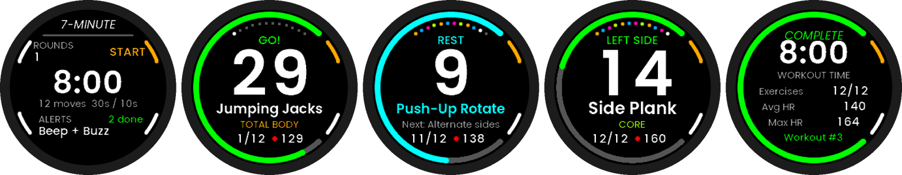
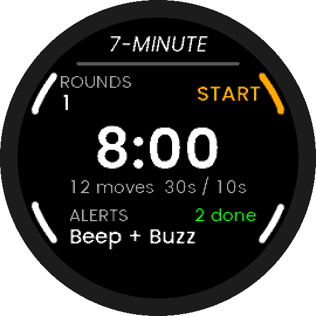
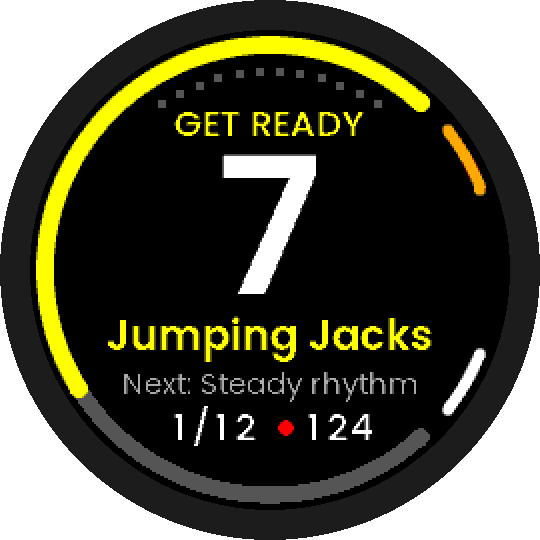
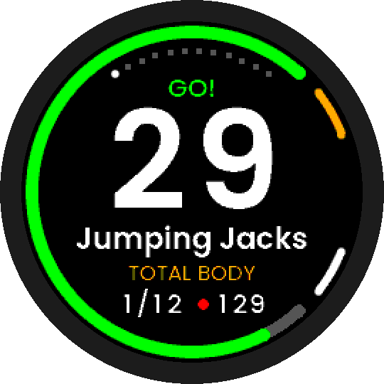
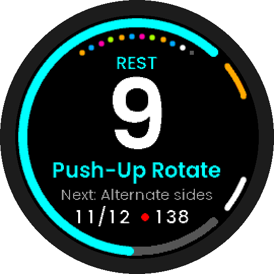
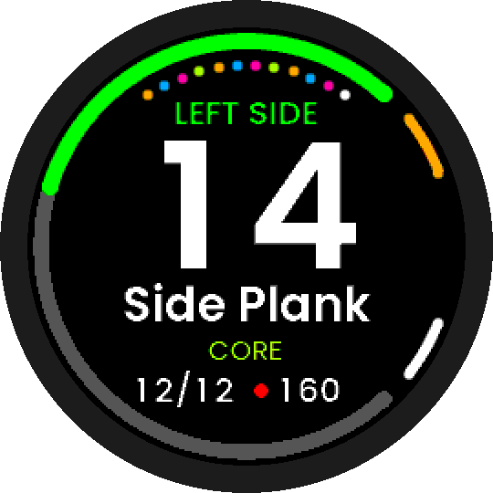
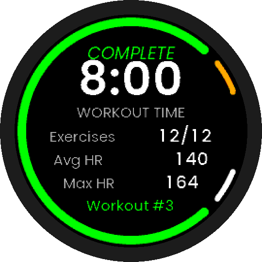

# 7-Minute — the scientific 7-minute workout for UNA Watch



**7-Minute** turns the UNA Watch into a coach for the high-intensity circuit
published by Klika & Jordan in *ACSM's Health & Fitness Journal* (2013), the
workout the New York Times made famous as
["The Scientific 7-Minute Workout"](https://archive.nytimes.com/well.blogs.nytimes.com/2013/05/09/the-scientific-7-minute-workout/).

The whole workout runs on **sound and vibration**. You never have to look at your
wrist while you're in a plank. Each transition has its own beep pattern and its
own buzz, so you can tell them apart by ear or by feel.

Entry for the [UNA App Development Competition – October 2026](https://unawatch.com/blogs/news/una-apps-competition-october-2026).

---

## The workout

12 body-weight exercises, **30 s of work** each, **10 s transitions**. The order
alternates muscle groups (total body → lower → upper → core) so one group rests
while the next works. One round takes 8:00, including a 10 s lead-in. The authors
suggest 2–3 rounds, and you can pick 1–3 on the watch.

| # | Exercise | Group | | # | Exercise | Group |
|---|----------|-------|-|---|----------|-------|
| 1 | Jumping jacks | Total body | | 7 | Triceps dips (chair) | Upper body |
| 2 | Wall sit | Lower body | | 8 | Plank | Core |
| 3 | Push-ups | Upper body | | 9 | High knees / run in place | Total body |
| 4 | Crunches | Core | | 10 | Lunges | Lower body |
| 5 | Step-ups (chair) | Total body | | 11 | Push-up + rotation | Upper body |
| 6 | Squats | Lower body | | 12 | Side plank (15 s each side) | Core |

## Cues: you hear and feel every transition

| Moment | Beep (piezo) | Buzz (haptics) | Backlight |
|---|---|---|---|
| Last 3 s of every interval | short tick ×3 (2 kHz) | sharp tick ×3 | on |
| **GO**: work starts | one long high tone (2.8 kHz, 650 ms) | strong buzz | on |
| **REST**: work ends | falling double tone | double click | on |
| **Switch sides** (side plank, 15 s) | triple chirp | 2 × double click | on |
| Round complete | rising 3-note | long double click + buzz | on |
| **Finished** | C-E-G-C fanfare | 2 × long alert | on 8 s |
| Pause / resume | low / high blip | soft bump / click | — |

Choose **Beep + Buzz**, **Buzz only** (quiet gym, sleeping house) or **Beep only**.

The workout clock and all cues live in the app's **service** process, so they
stay exact even when the screen is off or the GUI isn't drawing. Each phase is
chained from the previous phase's end tick, so a late wake-up never makes the
workout drift (see the [verification](#verification) section).

## Using it

Each control sits next to its button. There are no menus to scroll.

**Start screen**

| Button | Action |
|---|---|
| L1 (top left) | Rounds 1 → 2 → 3 (planned time updates: 8:00 / 16:00 / 24:00) |
| L2 (bottom left) | Alerts: Beep + Buzz → Buzz only → Beep only |
| R1 (top right) | **Start** |
| R2 (bottom right) | Exit |

**During the workout**

- Huge seconds countdown, a ring that drains with the interval (yellow get
  ready, green work, cyan rest, grey paused)
- Current exercise and muscle group. During a rest you see the *next*
  exercise and a coaching tip.
- 12 progress dots that fill in each exercise's muscle-group colour
- Live heart rate, plus position (3/12) and round (ROUND 2/3)
- Side plank shows **RIGHT SIDE**, then **LEFT SIDE**

| Button | Action |
|---|---|
| R1 | Pause / resume |
| R2 | End… (pauses and asks: R2 again ends, R1 goes back, so one stray press never ends a workout) |
| L2 | Skip ahead |
| L1 | Restart this exercise. Within its first 3 s, or during a rest, it goes back to the previous one. |

**Summary**: workout time (pauses excluded), exercises completed, average and
max heart rate, and a lifetime workout count. R1 starts another workout, R2 goes home.

Settings and the lifetime count persist on the watch.

## Screens

| | |
|---|---|
|  Start |  Get ready |
|  Work |  Rest, next up |
|  Switch sides |  Summary |

## Project layout

```
Software/
  Libs/                         service process + shared logic (no GUI)
    Header/WorkoutPlan.hpp      the protocol: exercises, timings
    Header/WorkoutEngine.hpp    tick-driven state machine, cue scheduling (SDK-free, unit-tested)
    Sources/Service.cpp         clock, buzzer/vibro/backlight cues, heart rate, settings
    Header/Commands.hpp         service <-> GUI messages
  Apps/
    SevenMinute-CMake/          watch build -> .uapp
    LVGL-GUI/                   GUI process (LVGL): Home, Workout, Summary screens
      assets/                   Poppins fonts (generated C committed)
      simulator/                PC simulator (SDL2), with audible beeps
Tests/                          host unit tests for the engine
Tools/                          packaging, icons, simulator tour & full-run checker
Resources/                      launcher icons
```

## Building

Requirements: the [UNA SDK](https://github.com/UNAWatch/una-sdk) with its LVGL
submodule, CMake ≥ 3.21, an ARM GCC toolchain and Python 3. See the SDK's
[setup guide](https://www.developers.unawatch.com/latest/sdk-setup.html).

```bash
git clone https://github.com/UNAWatch/una-sdk.git
git -C una-sdk submodule update --init ThirdParty/lvgl
export UNA_SDK=$PWD/una-sdk
python3 -m pip install -r $UNA_SDK/Utilities/Scripts/app_packer/requirements.txt

# Watch app (.uapp is written to build/ and copied to Output/)
cmake -G "Unix Makefiles" -S Software/Apps/SevenMinute-CMake -B build
cmake --build build
```

To install by USB: copy `SevenMinute_<version>.uapp` into `Apps/7-Minute/` on
the watch drive, eject it, power-cycle the watch, then find **7-Minute** in the
launcher.

### Simulator (Linux / WSL / Windows)

```bash
sudo apt-get install build-essential cmake ninja-build libsdl2-dev   # Debian/Ubuntu
cd Software/Apps/LVGL-GUI/simulator
cmake -S . -B build -G Ninja -DCMAKE_BUILD_TYPE=Debug
cmake --build build
(cd build/bin && ./SevenMinuteSimulator)
```

Keys **1 2 3 4** = L1 L2 R1 R2, **Esc** quits. The simulator plays the cues
through your speakers (set `UNA_SIM_MUTE=1` to silence them) and logs every cue
with its timestamp.

### Tests

```bash
cmake -S Tests -B build-tests && cmake --build build-tests && ctest --test-dir build-tests
```

The engine tests cover:

- the full 1- and 3-round timelines, down to the millisecond
- countdown and side-switch timing
- pause/resume, with pauses excluded from workout time
- skip forward and back, including across a round boundary
- ending early
- late and very late wake-ups (no drift)
- 32-bit tick wrap-around mid-workout

### Verification

- `Tools/sim_fullrun.sh` runs a complete, unskipped workout in the simulator
  and checks every logged cue against the protocol.
- `Tools/sim_tour.sh` drives every screen and saves screenshots.
- `Tools/roundify.py` masks the screenshots to the round face.

## Publishing (competition entry)

1. Sign up at [apps.unawatch.com](https://apps.unawatch.com), click **Add New**,
   name it *7-Minute* and generate an **App ID**.
2. Put that ID in `APP_ID` in `Software/Apps/SevenMinute-CMake/CMakeLists.txt`
   (it currently holds a locally generated placeholder).
3. Tag a version (`git tag v1.0.0`) and run `UNA_SDK=... Tools/package.sh`. This
   builds and writes `Output/SevenMinute_<version>_store.zip` (`.uapp`,
   `app-manifest.json`, icon and preview screenshots).
4. On the app page: **Version → Upload New** → upload the zip → **Release** →
   **Confirm and Publish**.
5. Submit the entry through the competition's [Google Form](https://forms.gle/MTWZYWsVgB6UvrxA7)
   before **30 October 2026, 4 pm UK time**.

Competition rules in short: the app must be new to the community store, entrants
must be 18+, each person may enter at most 2 apps, and no watch is needed (the
simulator counts). Apps are judged on usefulness, originality and UX/UI,
10 points each.

## Safety

This is a high-intensity workout. Check with a doctor before starting if you
have heart, joint or blood-pressure conditions. Scale the moves (knee push-ups,
shallower squats) and stop if you feel dizzy or have pain.

## Sources

- Klika B., Jordan C. *High-intensity circuit training using body weight:
  Maximum results with minimum investment.* ACSM's Health & Fitness Journal
  17(3):8–13, 2013. doi:[10.1249/FIT.0b013e31828cb1e8](https://doi.org/10.1249/FIT.0b013e31828cb1e8)
- Reynolds G. *The Scientific 7-Minute Workout.* The New York Times (Well), 9 May 2013.
- [UNA Watch SDK documentation](https://www.developers.unawatch.com/)

## License

MIT. See [LICENSE](LICENSE) and [THIRD-PARTY-NOTICES.md](THIRD-PARTY-NOTICES.md).
